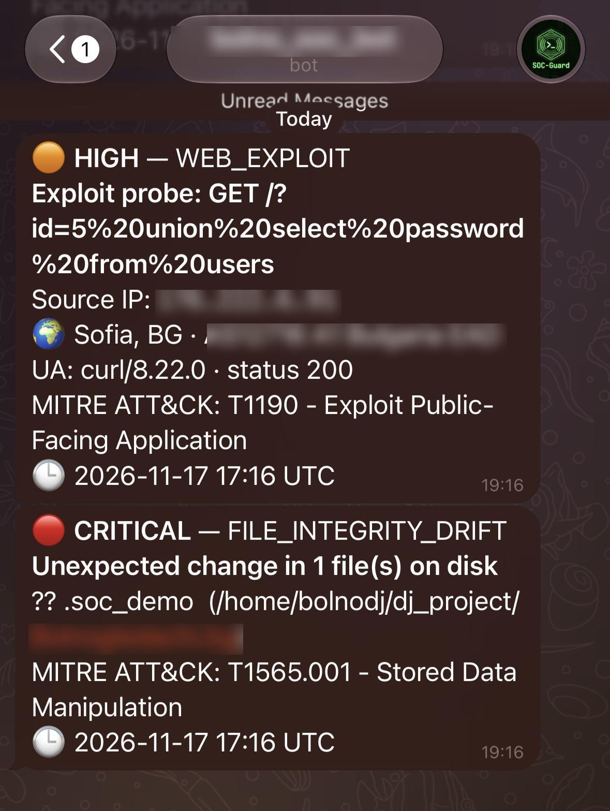
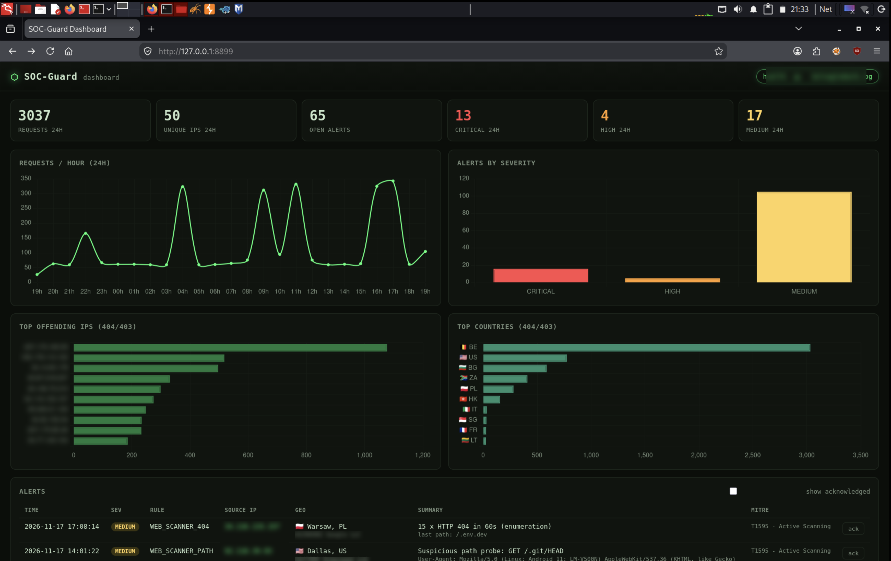

<p align="center">
  
</p>

<p align="center">
  <em>Self-hosted SIEM-lite for a single Linux web server — detections mapped to MITRE ATT&CK, real-time Telegram alerts, ~14&nbsp;MB RAM.</em>
</p>

<p align="center">
  <a href="https://github.com/darkyordanov/soc-guard/actions/workflows/ci.yml"></a>
  
  
  
  
</p>

---

**A self-hosted SIEM-lite for a single Linux web server.** Pure Python 3
stdlib — no dependencies, no agent, no 4 GB stack. It tails your web access log
and the SSH journal, detects attacker behaviour with rules mapped to
**MITRE ATT&CK**, watches critical files for tampering, enriches offender IPs
with **GeoIP**, stores everything in SQLite, and pushes real-time **Telegram**
alerts. A daily report and an external dead-man's-switch heartbeat round it out.

> Built to run on a small VPS alongside your app — the collector uses about
> **14 MB of RAM**.

```
          ┌───────────────── your Linux web server ──────────────────┐
 access.log ─┐                                                        │
 (nginx/apache) ├──tail──▶┌──────────────┐    ┌─────────┐   ┌────────┐│
 SSH journal ───┘         │  soc_guard   │───▶│ SQLite  │   │Telegram││
 journalctl -u ssh        │  detections  │───▶│ soc.db  │──▶│CRIT/HGH││
 watched files ─────fim──▶│  + FIM       │    └─────────┘   └────────┘│
 HTTP health probe ──────▶│  + GeoIP     │          ▲                 │
          │               └──────┬───────┘   GeoLite2 .mmdb           │
          └───── heartbeat.sh ───┼── cron */5 ──▶ healthchecks.io ─────┘
                 soc_report.py ──┴── cron 08:00 ─▶ Telegram daily report
```

<p align="center">
  
</p>

<p align="center">
  <em>Real alerts from a live deployment: a SQLi probe caught at the edge, and a file changing on disk — each tagged with its MITRE technique and enriched with GeoIP.</em>
</p>

## Features

- **Zero dependencies** — Python 3 stdlib only; auditable, no supply-chain CVEs.
  Includes a from-scratch MaxMind `.mmdb` reader (`src/mmdb.py`) so GeoIP needs
  no `geoip2` package.
- **Config-driven** — every path, threshold, allowlist and secret lives in one
  env file. Deploy on a new host without touching code.
- **MITRE ATT&CK-mapped detections** — T1078, T1110, T1190, T1499, T1565.001,
  T1595.
- **File Integrity Monitoring** — hash-based, portable (no git required); alerts
  on modified / deleted / newly-appeared files in a configured scope.
- **GeoIP enrichment** — every IP-bearing alert carries `City, CC · ASxxx Org`.
- **Real-time Telegram alerts** for `CRITICAL`/`HIGH`, de-duplicated per source.
- **External heartbeat** — if the whole host dies, the monitor still alerts you.
- **Daily report** — traffic, alert breakdown, top offending IPs.
- **Runs unprivileged + systemd-sandboxed** — read-only on logs, no root,
  write access limited to its own data dir.

## Detection rules

| Rule | Severity | MITRE ATT&CK | Trigger |
|------|----------|--------------|---------|
| `SSH_LOGIN_UNEXPECTED` | CRITICAL | T1078 Valid Accounts | successful SSH login by a user not in the allowlist |
| `SITE_DOWN` | CRITICAL | T1499 Endpoint DoS | HTTP health check fails 3× in a row |
| `FILE_INTEGRITY_MODIFIED` | HIGH | T1565.001 Stored Data Manipulation | a watched file's SHA-256 changed |
| `FILE_INTEGRITY_DELETED` | HIGH | T1565.001 Stored Data Manipulation | a watched file disappeared |
| `FILE_INTEGRITY_NEW` | MEDIUM | T1565.001 Stored Data Manipulation | a new file appeared in a watched glob |
| `WEB_EXPLOIT` | HIGH | T1190 Exploit Public-Facing App | SQLi / XSS / traversal / cmd-inj signature in a request URI |
| `SSH_BRUTEFORCE` | HIGH | T1110 Brute Force | > N failed SSH / window / IP |
| `HTTP_5XX_SPIKE` | HIGH | T1499 Endpoint DoS | > N server errors / window (site-wide) |
| `WEB_SCANNER_PATH` | MEDIUM | T1595 Active Scanning | request to `/.env`, `/.git`, `/api/`, `wp-admin`, … |
| `WEB_SCANNER_404` | MEDIUM | T1595 Active Scanning | > N × HTTP 404 / window / IP |

Thresholds are configurable. Details & tuning: [docs/02-detection-rules.md](docs/02-detection-rules.md).

## Detection-as-Code

Detections aren't just regexes buried in a script — they're managed like code:

- **Portable rules** — every detection is also a [Sigma](https://sigmahq.io)
  rule in [`detections/`](detections/), convertible to Splunk, Elastic,
  Sentinel and others via pySigma. One rule, written once, runs anywhere.
- **Tested** — [`tests/`](tests/) feeds synthetic malicious *and* benign log
  lines through the detection functions and asserts the right rule fires (and
  nothing fires on clean traffic). 55 tests, run on every push.
- **CI-validated** — [GitHub Actions](.github/workflows/ci.yml) lints, runs the
  tests, and validates every Sigma rule on each push and PR.
- **ATT&CK-mapped** — coverage is tracked as a
  [Navigator layer](detections/navigator/) generated from the rules' own tags.

Full write-up: [docs/04-detection-as-code.md](docs/04-detection-as-code.md).

## Dashboard

A read-only FastAPI + HTMX dashboard bound to `127.0.0.1` and reached over an
SSH tunnel — no public port, no new attack surface. Live alert table with
one-click acknowledge, traffic and severity charts, top offending IPs, and a
GeoIP country breakdown.



More: [dashboard/README.md](dashboard/README.md).

## Quick start

```bash
git clone https://github.com/darkyordanov/soc-guard.git
cd soc-guard
sudo cp examples/soc-guard.env.example /etc/soc-guard/soc-guard.env
sudo nano /etc/soc-guard/soc-guard.env          # fill in token, paths, allowlist
# ...then follow docs/INSTALL.md (user, service, cron, heartbeat)
```

Full step-by-step for any server: **[docs/INSTALL.md](docs/INSTALL.md)**.

## Requirements

- Linux with **systemd** and **journald** (Debian/Ubuntu or RHEL/Alma/Rocky)
- Python 3.8+ (stdlib only)
- nginx or apache access log in combined/common format
- A Telegram bot (free) for alerts; optionally a healthchecks.io check (free)
- Optional, for GeoIP: free MaxMind GeoLite2 databases via `geoipupdate`

## Documentation

- [docs/INSTALL.md](docs/INSTALL.md) — install on your own server, step by step
- [docs/00-overview.md](docs/00-overview.md) — design, threat model, why not Wazuh
- [docs/01-architecture.md](docs/01-architecture.md) — components & data flow
- [docs/02-detection-rules.md](docs/02-detection-rules.md) — rules → MITRE ATT&CK
- [docs/03-ir-playbooks.md](docs/03-ir-playbooks.md) — incident-response playbooks
- [docs/04-detection-as-code.md](docs/04-detection-as-code.md) — Sigma rules, tests & CI pipeline

## Roadmap

- [x] FastAPI + HTMX web dashboard (live alerts, acknowledge, traffic charts)
- [x] File Integrity Monitoring (hash-based config/content drift detection)
- [x] GeoIP / ASN enrichment on offender IPs
- [x] SQLi/XSS probe detection on request URIs
- [x] Detection-as-Code — Sigma rules, pytest suite, CI, ATT&CK Navigator layer
- [ ] Apache-tuned log regex preset
- [ ] Optional abuse-feed correlation (e.g. local AbuseIPDB cache)

## Scope & ethics

Defensive tooling for infrastructure **you own or are authorized to monitor**.
It watches your own logs and your own service health. It performs no scanning
of third parties.

## License

MIT — see [LICENSE](LICENSE).
