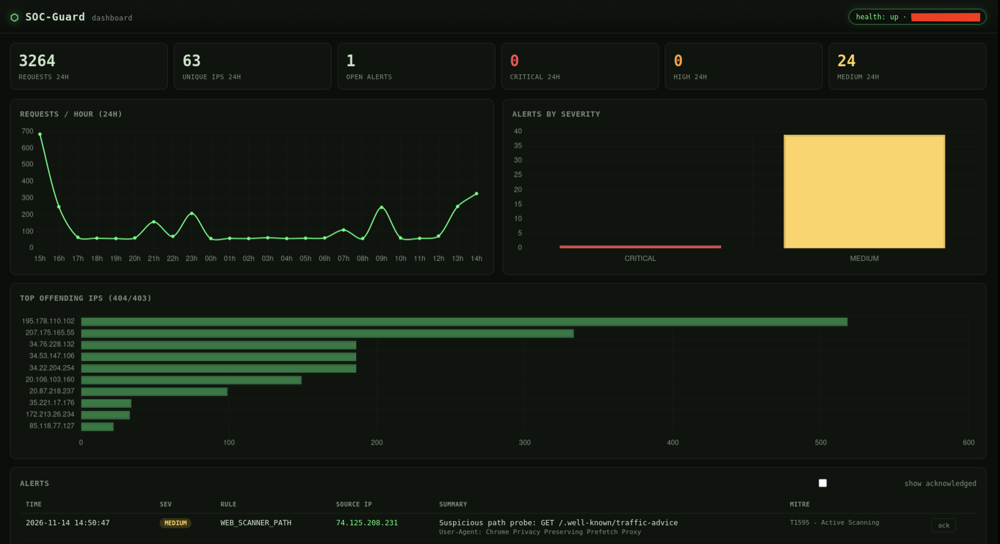

# SOC-Guard Dashboard

A FastAPI + HTMX read/ack view over the SOC-Guard collector's SQLite DB.
It binds to **127.0.0.1 only** and is reached over an **SSH tunnel** — there is
no public listening port, no extra TLS, and no new attack surface.



## Why an SSH tunnel (not a public login page)

A public dashboard — even behind a login — adds attack surface: the login page
itself becomes a brute-force target, and any auth bug is an exposure. Binding to
localhost and tunnelling over the already-hardened (key-only) SSH means there is
**no listening port on the internet at all**. Defense in depth, least exposure.

```
Browser ──SSH tunnel──▶ 127.0.0.1:8899 (server) ──▶ uvicorn ──read──▶ soc.db
```

## Features

- Live alert table (auto-refresh 10s), severity-coloured, one-click **ack**
- Stat tiles: requests / unique IPs (24h), open alerts, CRIT / HIGH / MED
- Charts: requests per hour, alerts by severity, top offending IPs
- Event search (IP / path / status)
- Read-only over the DB — the only write is toggling an alert's `acknowledged`
- Runs as an unprivileged `socdash` user, systemd-sandboxed

## Access (SSH tunnel)

On your laptop, open the tunnel, then browse to the local end:

```bash
ssh -N -L 8899:127.0.0.1:8899 youruser@yourserver
# then open http://127.0.0.1:8899
```

## Install

Install the collector first (see ../docs/INSTALL.md). Then, as a dedicated
dashboard user with read access to the collector's DB:

```bash
# unprivileged user; needs to read the collector's data dir + DB
sudo useradd -r -M -s /usr/sbin/nologin socdash
sudo usermod -aG <collector-group> socdash        # e.g. the 'soc' group
# WAL-mode SQLite: the reader needs rw on the db + its -wal/-shm sidecars
sudo chmod 660 /path/to/soc.db /path/to/soc.db-wal /path/to/soc.db-shm

sudo install -d -o socdash -g socdash /opt/soc-dash
sudo cp -r app requirements.txt /opt/soc-dash/
sudo python3 -m venv /opt/soc-dash/venv
sudo /opt/soc-dash/venv/bin/pip install -r /opt/soc-dash/requirements.txt
sudo chown -R socdash:socdash /opt/soc-dash

sudo cp soc-dash.service /etc/systemd/system/
sudo systemctl enable --now soc-dash
```

Configure via the service `Environment=` lines (DB path, site URL, host, port).
The service binds to `127.0.0.1:8899` by default.

## Notes

- WAL-mode SQLite requires the reader to have write access to the `-wal` /
  `-shm` sidecar files, not just the DB.
- If you must expose it, put it behind nginx on a subdomain with TLS, HTTP
  Basic auth, and an IP allowlist — and accept the added surface. The tunnel
  is recommended.

## Stack

FastAPI · uvicorn · Jinja2 · HTMX · Chart.js · SQLite (read-only)
